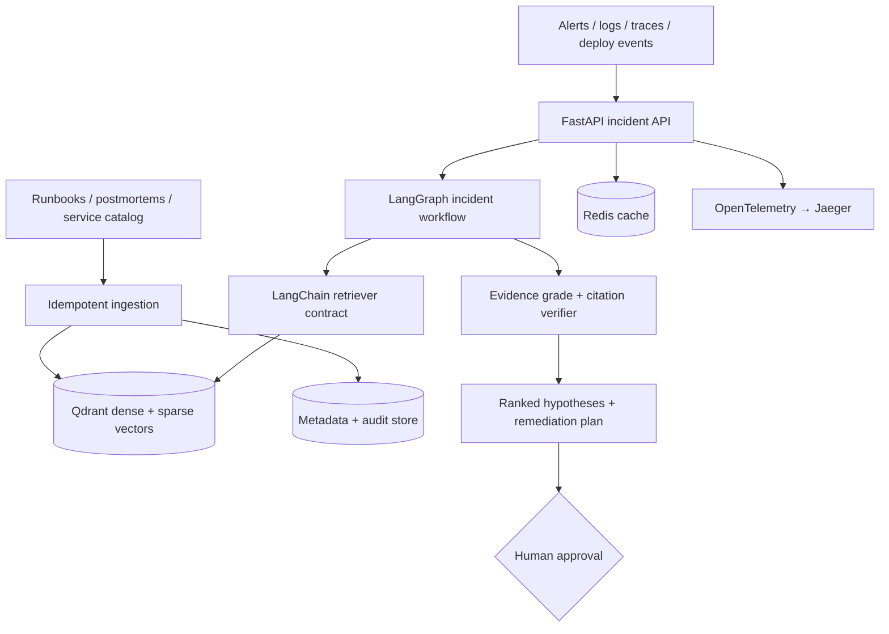

# AegisRAG — AI Incident Commander

> An agentic production-intelligence platform that correlates telemetry, runbooks, service ownership, deployments, and prior incidents to produce verified root-cause hypotheses and safe remediation plans.

AegisRAG is a portfolio-grade backend system for Site Reliability Engineering and production operations. Instead of another “chat with a PDF” demo, it answers the question engineers face during an outage: **what is failing, why is it failing, what evidence supports that conclusion, and what is safe to do next?**

Every conclusion is tenant-isolated, citation-backed, checkpointed, observable, and kept behind a human-approval boundary.



## What makes this project different

- **Agentic RAG with bounded control flow.** LangGraph runs `retrieve → grade → rewrite → generate → verify`. Weak evidence gets one query rewrite; unresolved incidents abstain instead of looping or hallucinating.
- **Retrieval engineering, not a framework default.** The offline engine implements lexical+dense retrieval, Reciprocal Rank Fusion, and MMR. The production adapter uses Qdrant named dense/sparse vectors, tenant filters, and server-side RRF.
- **Incident-specific output.** `/v1/incidents/analyze` returns severity, ranked root-cause hypotheses, confidence, exact evidence, remediation steps, and whether privileged execution requires approval.
- **Checkpointed and replayable.** LangGraph state is keyed by tenant and incident thread. SQLite checkpointing is available locally; the architecture supports PostgreSQL-backed checkpoints for multi-worker deployment.
- **Safe by design.** Retrieved text is untrusted, prompt-injection patterns are filtered, tenant predicates exist at storage boundaries, citations are deterministically verified, and rollback/failover/data mutations require human approval.
- **Measurable quality.** A golden benchmark gates Recall@K, MRR, and nDCG in CI. Retrieval, graph, API, isolation, injection, abstention, and incident contracts have automated tests.
- **Production observability.** Request IDs, low-cardinality Prometheus metrics, structured logs, OpenTelemetry instrumentation, and Jaeger tracing make failure paths inspectable.

## Technology stack

| Layer | Technologies |
| --- | --- |
| Agent orchestration | LangGraph, checkpointed state, conditional edges, bounded retry |
| AI interfaces | LangChain Core retrievers/documents; provider-ready answer contract |
| Retrieval | Qdrant, dense+sparse vectors, RRF, local MMR fallback |
| API | Python 3.11+, FastAPI, Pydantic, OpenAPI |
| Data and cache | SQLite local metadata, Redis response cache, PostgreSQL-ready checkpoints |
| Observability | OpenTelemetry, OTLP, Jaeger, Prometheus-format metrics, JSON logs |
| Delivery | Docker Compose, GitHub Actions, pytest, Ruff, smoke tests |

## Agent workflow

```text
incident + telemetry
        │
        ▼
retrieve evidence ───────────────┐
        │                        │
        ▼                        │
grade evidence                   │
   │ sufficient                  │ weak (one retry)
   ▼                             │
generate analysis        rewrite query
        │                        │
        ▼                        └──────────────┘
verify every [C#] citation
   │ valid              │ invalid
   ▼                    ▼
rank hypotheses       abstain
        │
        ▼
human approval boundary
```

See [the detailed graph design](docs/AGENT_GRAPH.md) and [production stack](docs/PRODUCTION_STACK.md).

## Quickstart: zero external services

Requirements: Python 3.11+.

```bash
python3 -m venv .venv
source .venv/bin/activate
python3 -m pip install -e '.[dev]'
cp .env.example .env

make demo
make simulate   # telemetry → alert → incident → LangGraph → stored timeline
make test
make eval
make smoke
```

The offline profile uses deterministic embeddings, SQLite metadata, an in-memory LangGraph checkpointer, and no API keys. This keeps CI reproducible and lets an interviewer run the system immediately.

### First successful run

From a fresh clone, execute these commands in order:

```bash
# 1. Create and activate an isolated Python environment
python3 -m venv .venv
source .venv/bin/activate             # Windows PowerShell: .venv\Scripts\Activate.ps1

# 2. Install the application and developer tools
python3 -m pip install --upgrade pip
python3 -m pip install -e '.[dev]'

# 3. Create local configuration
cp .env.example .env

# 4. Prove the complete local system works
make test
make eval
make simulate
make smoke
```

Expected results:

```text
16 tests passed
recall_at_k: 1.0
gate_passed: true
scenario status: incident_created
expected_outcome_verified: true
AegisRAG smoke test passed
```

The exact test count can increase as the project evolves. A non-zero command exit means the corresponding quality gate failed.

### Start the API locally

```bash
source .venv/bin/activate
python3 -m uvicorn aegis_rag.api:app --host 127.0.0.1 --port 8000 --reload
```

Open:

- Incident Commander dashboard: `http://127.0.0.1:8000/demo`
- Swagger UI: `http://127.0.0.1:8000/docs`
- OpenAPI document: `http://127.0.0.1:8000/openapi.json`
- Liveness: `http://127.0.0.1:8000/healthz`
- Readiness: `http://127.0.0.1:8000/readyz`
- Metrics: `http://127.0.0.1:8000/metrics`

The dashboard is the recommended demo. It makes the data provenance explicit: scenario events
come from deterministic YAML fixtures under `data/scenarios`, are replayed and written to the
tenant-scoped `telemetry_events` table, and produce a stored incident only after the declared
consecutive-sample alert rule fires. The interface visualizes the alert boundary, persisted event
timeline, LangGraph stages, ranked hypotheses, verified citations, and human-approval boundary.
After analysis it reloads the report through `GET /v1/incidents/{id}` to prove that the report and
timeline were persisted rather than held only in the browser response.

In a second terminal, list and run scenarios:

```bash
curl -s http://127.0.0.1:8000/v1/scenarios \
  -H 'x-tenant-id: acme-payments'

curl -s -X POST http://127.0.0.1:8000/v1/scenarios/run \
  -H 'content-type: application/json' \
  -H 'x-tenant-id: acme-payments' \
  -d '{"scenario_id":"payments-pool-exhaustion"}'
```

Copy the returned `incident.incident_id`, then retrieve its persisted report:

```bash
curl -s http://127.0.0.1:8000/v1/incidents/INC-SIM-REPLACE_ME \
  -H 'x-tenant-id: acme-payments'
```

## End-to-end incident simulation

```bash
make simulate
```

That command executes the full application path:

```text
YAML failure scenario
  → deployment, metric, log, and trace events
  → durable tenant-scoped telemetry records
  → consecutive-sample alert evaluation
  → incident creation
  → LangGraph evidence retrieval and investigation
  → deterministic citation verification
  → persisted incident report and timeline
  → expected-root-cause assertion
```

Three deterministic scenarios are included:

- `payments-pool-exhaustion`: deployment-driven PostgreSQL pool saturation and HTTP 503s.
- `checkout-redis-regression`: Redis N+1 calls causing checkout latency and timeouts.
- `healthy-payments-deployment`: control scenario that verifies normal variance does not open an incident.

Each scenario declares its tenant, service, events, alert threshold, required consecutive samples, relevant knowledge, and expected evidence. This makes detection and diagnosis reproducible rather than random.

Run them individually:

```bash
python3 -m aegis_rag simulate \
  --scenario payments-pool-exhaustion \
  --tenant acme-payments

python3 -m aegis_rag simulate \
  --scenario checkout-redis-regression \
  --tenant globex-commerce

python3 -m aegis_rag simulate \
  --scenario healthy-payments-deployment \
  --tenant acme-payments
```

The first two must create incidents. The healthy deployment must return `no_incident`. All three must return `expected_outcome_verified: true`.

## Project ownership and interview guide

The detailed guide at `output/pdf/AegisRAG_Interview_Ownership_Guide.pdf` explains the complete execution path, retrieval mathematics, LangGraph state machine, multi-tenant boundaries, safety model, evaluation strategy, limitations, production scaling plan, and interview questions. It also compares every major technology choice with credible alternatives and explains when those alternatives would be better.

The editable source is `docs/AEGISRAG_INTERVIEW_GUIDE.md`. To rebuild the PDF:

```bash
python3 -m pip install -e '.[dev,docs]'
make guide
```

Use the guide with the code-reading path near its end: follow one payments incident through `scenarios.py`, `store.py`, `retrieval.py`, `workflow.py`, `generation.py`, and `incidents.py`, then answer the included questions without notes.

## Production profile

```bash
docker compose up --build
```

This starts:

- AegisRAG API: `http://localhost:8000/docs`
- Qdrant: `http://localhost:6333/dashboard`
- Redis: `localhost:6379`
- Jaeger traces: `http://localhost:16686`

The API automatically switches to Qdrant dense+sparse RRF, Redis caching, durable SQLite LangGraph checkpoints, and OTLP tracing based on environment configuration.

Stop the stack without deleting data:

```bash
docker compose down
```

Delete only the named Docker volumes when you intentionally want a clean production-profile reset:

```bash
docker compose down --volumes
```

### Optional OpenAI generation

The deterministic extractive provider is the default and requires no key. To use structured LLM generation:

```bash
python3 -m pip install -e '.[dev,production]'
export OPENAI_API_KEY='your-key'
export AEGIS_RAG_ANSWER_PROVIDER=openai
export AEGIS_RAG_LLM_MODEL=gpt-5-mini
python3 -m uvicorn aegis_rag.api:app --port 8000
```

The LangGraph citation verifier still validates the model's evidence IDs. Do not commit `.env` or API keys.

## Analyze an incident

First ingest the sample corpus with `make demo`, or POST the runbooks through `/v1/ingest`. Then:

```bash
curl -X POST http://localhost:8000/v1/incidents/analyze \
  -H 'content-type: application/json' \
  -H 'x-tenant-id: acme' \
  -d '{
    "incident_id": "INC-9001",
    "title": "Payments API unavailable after deployment",
    "service": "payments-api",
    "symptoms": "All requests return HTTP 503 with db_pool_timeout",
    "telemetry": [
      "http.server.503.rate=100%",
      "db.pool.wait.p99=2500ms",
      "deployment=payments-2026.08.26.4"
    ]
  }'
```

Example response shape:

```json
{
  "incident_id": "INC-9001",
  "severity": "SEV-1",
  "summary": "The payments API returns HTTP 503 when PostgreSQL connections are exhausted. [C1]",
  "hypotheses": [
    {
      "rank": 1,
      "hypothesis": "The failure matches connection-pool exhaustion in the Payments runbook.",
      "confidence": 0.81,
      "evidence": ["C1"]
    }
  ],
  "recommended_actions": [
    "Validate the leading hypothesis against [C1] before changing state.",
    "Compare incident start time with the latest deployment.",
    "Require human approval for rollback, failover, or data repair."
  ],
  "approval_required": true,
  "workflow": {
    "engine": "langgraph",
    "nodes": ["retrieve", "grade_evidence", "generate", "verify_citations"],
    "rewrites": 0,
    "verification_passed": true,
    "thread_id": "INC-9001"
  }
}
```

## API surface

| Endpoint | Purpose |
| --- | --- |
| `GET /demo` | Open the visual incident-simulation and investigation dashboard |
| `POST /v1/incidents/analyze` | Run the checkpointed incident-analysis graph |
| `GET /v1/incidents/{id}` | Retrieve a tenant-scoped stored report and timeline |
| `GET /v1/scenarios` | List scenarios visible to the authenticated tenant |
| `GET /v1/scenarios/{id}` | Inspect a scenario's source events, alert rule, and persistence targets |
| `POST /v1/scenarios/run` | Generate telemetry, evaluate alerts, and investigate end to end |
| `POST /v1/ingest` | Idempotently ingest a runbook, postmortem, or service document |
| `POST /v1/query` | Ask an evidence-backed knowledge question through LangGraph |
| `GET /v1/documents` | List tenant-scoped sources |
| `POST /v1/evals/run` | Execute the retrieval quality gate |
| `GET /healthz` | Process liveness |
| `GET /readyz` | Dependency readiness |
| `GET /metrics` | Prometheus-compatible service metrics |

## Evaluation and testing

```bash
python3 -m aegis_rag eval --dataset data/eval/golden.jsonl
python3 -m pytest
./scripts/smoke.sh
```

The golden corpus covers operational policy, recovery objectives, payments connection-pool exhaustion, checkout N+1 cache access, and service ownership. CI rejects ranking changes that push Recall@K, MRR, or nDCG below configured thresholds.

### Verification checklist

Before publishing a change:

```bash
make lint
make test
make eval
make simulate
make smoke
```

What each command proves:

| Command | Proof |
| --- | --- |
| `make lint` | Source and test code meet static-quality rules |
| `make test` | API, graph, retrieval, tenancy, Qdrant, checkpoint, and scenario contracts pass |
| `make eval` | Retrieval quality remains above the CI gate |
| `make simulate` | Telemetry-to-incident causal path produces expected evidence |
| `make smoke` | A real HTTP server passes health, ingestion, query, scenario, and metrics checks |

## Troubleshooting

### `python` or `pytest` is not found

Use `python3 -m pytest` and confirm the virtual environment is active. All Make targets intentionally use `python3`.

### `ModuleNotFoundError: aegis_rag`

Run `python3 -m pip install -e '.[dev]'` from the repository root. Confirm `python3 -c 'import aegis_rag; print(aegis_rag.__version__)'` prints `0.2.0`.

### Port 8000 is already in use

Choose another port, for example `python3 -m uvicorn aegis_rag.api:app --port 8001`. The smoke test uses port 8765 by default and can be changed with `AEGIS_RAG_SMOKE_PORT`.

### Readiness fails in Docker

Check `docker compose ps` and `docker compose logs api qdrant redis`. The API readiness probe checks metadata storage and every configured Qdrant/Redis dependency.

### The evaluation gate fails after a retrieval change

Inspect dense and lexical rankings independently, confirm compound-token normalization, and compare the relevant chunk's rank before changing thresholds. Do not lower the gate merely to make CI green.

## Repository map

```text
src/aegis_rag/
├── workflow.py            LangGraph retrieve/grade/rewrite/generate/verify graph
├── incidents.py           Severity, hypotheses, confidence, approval boundary
├── langchain_adapter.py   LangChain BaseRetriever integration
├── qdrant_store.py        Dense+sparse Qdrant indexing and RRF retrieval
├── retrieval.py           Local lexical+dense RRF and MMR engine
├── checkpointing.py       LangGraph checkpoint provider
├── cache.py               Redis tenant-safe response cache
├── telemetry.py           OpenTelemetry/OTLP instrumentation
├── ingestion.py           Structure-aware chunking and provenance
├── evaluation.py          Recall@K, MRR, nDCG quality gate
├── demo.html              Zero-build incident-command dashboard
└── api.py                 FastAPI application and contracts
```

## Engineering trade-offs

Why keep a custom retrieval engine when Qdrant and LangChain exist? Because framework calls alone do not demonstrate retrieval understanding. The local implementation makes ranking, fusion, diversity, provenance, and abstention testable. The production adapters demonstrate that those domain boundaries can scale without rewriting the application.

Why only one rewrite? During production incidents, bounded latency and explainability matter more than agent autonomy. Every additional loop increases cost, response time, and the chance of drifting from evidence.

Why no automatic rollback? Diagnosis and execution have different risk profiles. The system deliberately stops at an approval boundary so a future privileged tool can require authenticated, audited human authorization.

## Resume description

**AegisRAG — Agentic AI Incident Commander | Independent Project**

- Independently engineered a production-style, multi-tenant incident intelligence platform using LangGraph, LangChain, FastAPI, Qdrant, Redis, and OpenTelemetry; created deterministic deployment, log, metric, and trace scenarios that trigger alert rules and evidence-backed investigations.
- Built a checkpointed `retrieve → grade → rewrite → generate → verify` workflow with dense+sparse RRF, MMR reranking, deterministic citation validation, prompt-injection isolation, abstention, and human approval gates for privileged remediation.
- Implemented retrieval quality gates for Recall@K, MRR, and nDCG; added tenant-isolation/API/agent tests, structured observability, Docker Compose infrastructure, CI, and end-to-end smoke validation.

## Security

Read [SECURITY.md](SECURITY.md) and [the threat model](docs/THREAT_MODEL.md). Never ingest real credentials, customer data, or unrestricted production logs into the demo environment.

## License

MIT.
