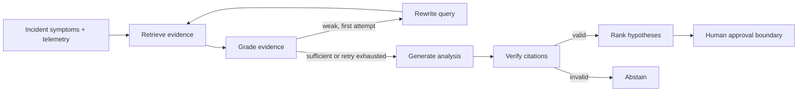

# Agentic incident-analysis graph

LangGraph owns this control flow and checkpoints state by `tenant_id:thread_id`. The graph stores raw questions and evidence rather than formatted prompts, making each node independently inspectable and replayable.

## Why the loop is bounded

Unbounded agent loops are expensive and difficult to reason about during an incident. AegisRAG performs at most one query rewrite. If evidence remains weak, it abstains and escalates to the service owner.

## Why verification is deterministic

Generation cannot declare itself grounded. The verifier parses every citation marker and confirms it references evidence that was actually selected. An invalid citation converts the result to an abstention.

## Human-in-the-loop boundary

The graph may recommend rollback, failover, or capacity changes, but `approval_required` remains true. A production extension would use a LangGraph interrupt and an authenticated approval event before any privileged tool executes.
